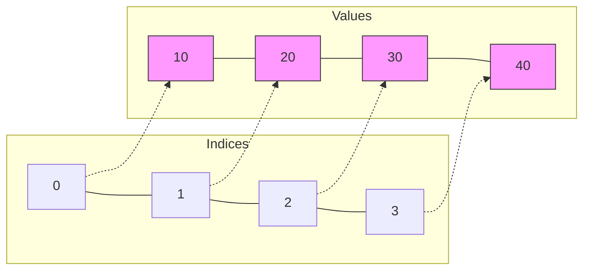
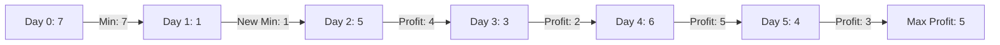
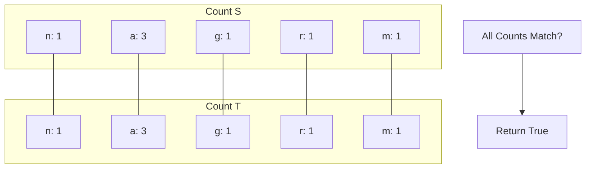

# 01 — Arrays & Strings (Complete)

> Consolidated from foundations, toolkit, and practice notes into one file.


---

# Foundations


## Arrays Intro

# Arrays: The "Box" Analogy

Think of an Array as a **row of numbered boxes**.
*   Each box holds one item.
*   The numbers (indices) start at **0**.
*   You can jump to any box instantly if you know its number.

## 1. Visualization

`arr = [10, 20, 30, 40]`



> [!TIP]
> **Why use Arrays?**
> Because reading `arr[500]` takes the exact same time as reading `arr[0]`. It's **Instant Access**.

## 2. Practical Operations (Python)

### A. Creating
```python
# Empty list
nums = []

# List with values
scores = [98, 85, 76]

# List of size N with default value (VERY USEFUL)
zeros = [0] * 10  # [0, 0, 0, ..., 0]
```

### B. Adding Items
> [!WARNING]
> **Performance Trap!**
> Adding to the **End** is fast. Adding to the **Start** is slow (everyone has to shift).

```python
nums = [1, 2, 3]

# 1. Append (Fast - O(1))
nums.append(4)      # [1, 2, 3, 4] -> Good!

# 2. Insert (Slow - O(N))
nums.insert(0, 99)  # [99, 1, 2, 3, 4] -> Bad for large lists!
```

### C. Removing Items
Same rule applies: Removing from the end is cheap. Removing from the start is expensive.

```python
# 1. Pop from End (Fast)
last = nums.pop()   # Returns 4, nums is [99, 1, 2, 3]

# 2. Pop from Index (Slow)
first = nums.pop(0) # Returns 99, nums is [1, 2, 3] -> Everyone shifts left!
```

## 3. Iterating (The Right Way)

**Scenario 1: Just the values**
```python
for score in scores:
    print(score)
```

**Scenario 2: I need the Index too!**
> [!NOTE]
> Don't use `range(len(arr))` unless you have to. Use `enumerate`.

```python
# Professional Way
for i, score in enumerate(scores):
    print(f"Student {i} got {score}")

# Amateur Way
for i in range(len(scores)):
    print(f"Student {i} got {scores[i]}")
```

## 4. Slicing (The Magic Trick)
Python lets you grab a chunk of the array easily.
`arr[start : end : step]`

```python
nums = [0, 1, 2, 3, 4, 5]

print(nums[1:4])   # [1, 2, 3] (Start inclusive, End exclusive)
print(nums[:3])    # [0, 1, 2] (Start to index 3)
print(nums[3:])    # [3, 4, 5] (Index 3 to end)
print(nums[::-1])  # [5, 4, 3, 2, 1, 0] (Reverse!)
```

> [!CAUTION]
> **Slicing creates a COPY.**
> `new_list = nums[:]` copies the whole list. If `nums` has 1 million items, this takes time and memory.


## Strings Intro

# Strings: Arrays of Characters (But Stricter)

A String is just a sequence of characters, like `['H', 'e', 'l', 'l', 'o']`.
But there is one **Massive Difference**: You cannot change them.

## 1. The Golden Rule: Immutability

> [!IMPORTANT]
> **Strings cannot be changed.**
> If you try to change one letter, Python creates a **whole new string**.

### Visualization
`s = "Cat"`
`s[0] = "R"` -> **ERROR!**

To change "Cat" to "Rat", you must create a new string:
`s = "R" + s[1:]`

```mermaid
graph LR
    Old[Address 100: "Cat"]
    New[Address 200: "Rat"]
    Var[Variable 's']
    
    Var --Points to--> Old
    Var --Update--> New
    
    style Old fill:#ff9,stroke:#333
    style New fill:#9f9,stroke:#333
```

> [!WARNING]
> **The Loop Trap**
> ```python
> # BAD CODE
> s = ""
> for char in huge_list:
>     s += char  # Creates a NEW string 1 million times!
> ```
> **Solution**: Use a list and `join`.
> ```python
> # GOOD CODE
> parts = []
> for char in huge_list:
>     parts.append(char)
> s = "".join(parts) # Creates string ONCE at the end.
> ```

## 2. The Toolkit (Methods you MUST know)

### A. Cleaning & Checking
```python
s = "  Hello World  "

print(s.strip())        # "Hello World" (Removes whitespace)
print(s.lower())        # "  hello world  " (Case insensitive checks)
print(s.startswith(" "))# True
print("World" in s)     # True (Substring check)
```

### B. Splitting & Joining (The Dynamic Duo)
Used constantly in parsing inputs.

```python
# 1. Split: String -> List
sentence = "apple,banana,cherry"
fruits = sentence.split(",")  # ['apple', 'banana', 'cherry']

# 2. Join: List -> String
new_sentence = " - ".join(fruits) # "apple - banana - cherry"
```

### C. Finding Things
```python
s = "banana"

print(s.find("na"))   # 2 (Index of first match)
print(s.find("z"))    # -1 (Not found - Safe!)
# print(s.index("z")) # ERROR! (Don't use this unless you're sure)
```

## 3. Palindromes (The Classic Interview Q)
A palindrome reads the same forwards and backwards.

**The Python One-Liner:**
```python
def is_palindrome(s):
    return s == s[::-1]
```

**The Two-Pointer Way (Memory Efficient):**
```python
def is_palindrome(s):
    l, r = 0, len(s) - 1
    while l < r:
        if s[l] != s[r]:
            return False
        l += 1
        r -= 1
    return True
```


---

# Toolkit — Patterns Reference


## Essential Methods

# Toolkit: Essential Methods Cheatsheet

This is your "Swiss Army Knife" for Array/String problems. Memorize these.

## 1. Sorting

> [!TIP]
> Sorting takes **O(N log N)**. Use it when `N < 10^6`.

```python
nums = [3, 1, 4, 1, 5]

# 1. Sort In-Place (Modifies original)
nums.sort()         # nums is now [1, 1, 3, 4, 5]

# 2. Return New Sorted List (Original stays same)
new_nums = sorted(nums, reverse=True) # [5, 4, 3, 1, 1]

# 3. Custom Sort (Lambda)
words = ["apple", "bat", "cat"]
# Sort by length
words.sort(key=lambda x: len(x)) 
```

## 2. List Comprehensions (Python Superpower)

Write concise, readable code.
`[expression for item in list if condition]`

```python
nums = [1, 2, 3, 4, 5]

# Square everything
squares = [x*x for x in nums]  # [1, 4, 9, 16, 25]

# Filter evens
evens = [x for x in nums if x % 2 == 0] # [2, 4]

# 2D Array (Matrix) of 0s
matrix = [[0] * 5 for _ in range(3)] # 3 rows, 5 cols
```

## 3. Math Helpers

```python
nums = [10, 20, 30]

print(max(nums))    # 30
print(min(nums))    # 10
print(sum(nums))    # 60
print(abs(-5))      # 5
```

## 4. Common Pitfalls (Don't do this!)

### A. Modifying while Iterating
**Bad**:
```python
for item in nums:
    if item < 5:
        nums.remove(item) # CHAOS! Indices shift while you loop.
```
**Good**:
Create a new list or iterate backwards.

### B. The `is` vs `==` Trap
*   `==` checks **Values** (Is the content the same?).
*   `is` checks **Memory Address** (Is it the exact same object?).

```python
a = [1, 2, 3]
b = [1, 2, 3]

print(a == b) # True (Content matches)
print(a is b) # False (Different boxes in memory)
```

### C. Shallow Copy Trap
```python
row = [0, 0]
matrix = [row] * 3  # [[0,0], [0,0], [0,0]]
matrix[0][0] = 1
# Result: [[1,0], [1,0], [1,0]] -> ALL rows changed!
# Why? They all point to the SAME 'row' object.
```
**Fix**: Use List Comprehension: `[[0, 0] for _ in range(3)]`.


## Two Pointers

# Blueprint: Two Pointers

**The Analogy**: Two people walking on a path.
*   **Opposite Ends**: Walking towards each other to meet.
*   **Same Direction**: One fast runner, one slow walker.

## 1. Opposite Ends (The "Pincer")

**Use Case**: Two Sum (Sorted), Reverse Array, Palindrome.
**Requirement**: Array is usually **Sorted**.

```python
def two_sum_sorted(nums, target):
    left = 0
    right = len(nums) - 1
    
    while left < right:
        current_sum = nums[left] + nums[right]
        
        if current_sum == target:
            return [left, right]
        elif current_sum < target:
            left += 1  # Need bigger number -> Move Left forward
        else:
            right -= 1 # Need smaller number -> Move Right backward
            
    return []
```

## 2. Same Direction (The "Race")

**Use Case**: Remove Duplicates, Move Zeroes.
**Logic**: `Fast` explores, `Slow` builds the result.

```python
def remove_duplicates(nums):
    slow = 0
    
    for fast in range(1, len(nums)):
        if nums[fast] != nums[slow]:
            slow += 1
            nums[slow] = nums[fast] # Overwrite
            
    return slow + 1 # New length
```

## 3. Merging (The "Zipper")

**Use Case**: Merge Sorted Array, Merge Sort.

```python
def merge(arr1, arr2):
    p1, p2 = 0, 0
    res = []
    
    while p1 < len(arr1) and p2 < len(arr2):
        if arr1[p1] < arr2[p2]:
            res.append(arr1[p1])
            p1 += 1
        else:
            res.append(arr2[p2])
            p2 += 1
            
    # Add leftovers
    res.extend(arr1[p1:])
    res.extend(arr2[p2:])
    return res
```


## Sliding Window

# Blueprint: Sliding Window

**The Analogy**: Think of a **Worm** crawling along a tape.
*   The **Head** (Right Pointer) moves forward to eat (expand).
*   The **Tail** (Left Pointer) moves forward to poop (shrink).
*   The worm stretches and shrinks to satisfy a condition.

## 1. Fixed Size Window (The "Box")

**Use Case**: "Find max sum of subarray of size K".
**Logic**: The window size never changes. We just slide it one step.

```python
def fixed_window(nums, k):
    current_sum = 0
    max_sum = float('-inf')
    
    # 1. Build first window
    for i in range(k):
        current_sum += nums[i]
    max_sum = current_sum
    
    # 2. Slide
    for i in range(k, len(nums)):
        current_sum += nums[i]       # Add Head
        current_sum -= nums[i - k]   # Remove Tail
        max_sum = max(max_sum, current_sum)
        
    return max_sum
```

## 2. Dynamic Window (The "Caterpillar")

**Use Case**: "Longest substring with...", "Smallest subarray with..."
**Logic**: Expand `right` until invalid, then shrink `left` until valid again.

```python
def dynamic_window(s):
    left = 0
    max_len = 0
    window_counts = {}
    
    for right in range(len(s)):
        # 1. EXPAND (Add Head)
        char = s[right]
        window_counts[char] = window_counts.get(char, 0) + 1
        
        # 2. SHRINK (Remove Tail) - While condition is BROKEN
        while window_counts[char] > 1: # Example: No duplicates allowed
            remove_char = s[left]
            window_counts[remove_char] -= 1
            left += 1
            
        # 3. UPDATE RESULT (Window is now Valid)
        max_len = max(max_len, right - left + 1)
        
    return max_len
```

## 3. Common Pitfalls

> [!WARNING]
> **Negative Numbers**: If the problem involves "Sum" and "Negative Numbers", Sliding Window **DOES NOT WORK**.
> *   Why? Adding a number doesn't guarantee the sum increases.
> *   Fix: Use **Prefix Sum**.

> [!TIP]
> **Window Size**: `Length = Right - Left + 1`.


## Prefix Sum

# Blueprint: Prefix Sum

**The Concept**: A "Running Total".
Instead of storing `[10, 20, 30]`, we store `[10, 30, 60]`.

## 1. Range Sum Query (Immutable)

**Use Case**: "Calculate sum of `nums[i...j]` many times".
**Formula**: `Sum(i, j) = Prefix[j] - Prefix[i-1]`.

```python
class PrefixSum:
    def __init__(self, nums):
        # Pad with 0 to handle edge case (index -1)
        self.prefix = [0] * (len(nums) + 1)
        for i in range(len(nums)):
            self.prefix[i + 1] = self.prefix[i] + nums[i]
            
    def query(self, left, right):
        # Right is inclusive
        return self.prefix[right + 1] - self.prefix[left]
```

## 2. Subarray Sum Equals K (The Interview Favorite)

**Use Case**: "Find number of subarrays that sum to K".
**Logic**: If `Current_Sum - K` exists in our history, we found a subarray!
**Pattern**: `Hash Map + Prefix Sum`.

```python
def subarray_sum(nums, k):
    count = 0
    current_sum = 0
    
    # Map: {Prefix_Sum : Frequency}
    # Base Case: Sum 0 exists once (empty subarray)
    prefix_map = {0: 1}
    
    for num in nums:
        current_sum += num
        diff = current_sum - k
        
        # Did we see this difference before?
        if diff in prefix_map:
            count += prefix_map[diff]
            
        prefix_map[current_sum] = prefix_map.get(current_sum, 0) + 1
        
    return count
```

> [!TIP]
> **Why Hash Map?**
> Because we need to look up *past* sums instantly ($O(1)$).


## Hash Map Patterns

# Blueprint: Hash Map Patterns

**The Concept**: The "Magic Lookup".
Find anything in $O(1)$ time.

## 1. Frequency Counter (The Cheat Code)

**Use Case**: Anagrams, Top K Elements, "Most Frequent...".
**Tool**: `collections.Counter`.

```python
from collections import Counter

s = "banana"
counts = Counter(s) 
# Counter({'a': 3, 'n': 2, 'b': 1})

print(counts['a']) # 3
print(counts['z']) # 0 (Safe! Returns 0, doesn't crash)
```

## 2. The "Two Sum" Lookup

**Use Case**: Find pair `(A, B)` such that `A + B = Target`.
**Logic**: We are at `A`. We need `B`. Is `B` in the map?

```python
def two_sum(nums, target):
    seen = {} # {Value : Index}
    
    for i, num in enumerate(nums):
        diff = target - num
        
        if diff in seen:
            return [seen[diff], i]
            
        seen[num] = i
    return []
```

## 3. Grouping (Anagrams)

**Use Case**: "Group strings that are..."
**Tool**: `collections.defaultdict`.

```python
from collections import defaultdict

def group_anagrams(strs):
    # Default value is an empty list []
    groups = defaultdict(list)
    
    for s in strs:
        # Key must be immutable (Tuple)
        key = tuple(sorted(s))
        groups[key].append(s)
        
    return list(groups.values())
```

> [!CAUTION]
> **Mutable Keys**: You cannot use a `list` as a key in a dictionary.
> *   Bad: `d[[1, 2]] = "val"` -> Error.
> *   Good: `d[(1, 2)] = "val"` -> OK (Tuple).


---

# Practice — Arrays


## Two Sum

# ⚔️ LeetCode 1: Two Sum

**Difficulty**: Easy
**Pattern**: Hash Map

## 1. Problem Detail

Given an array of integers `nums` and an integer `target`, return indices of the two numbers such that they add up to `target`.

You may assume that each input would have **exactly one solution**, and you may not use the *same* element twice.

You can return the answer in any order.

**Example 1:**
```
Input: nums = [2,7,11,15], target = 9
Output: [0,1]
Explanation: Because nums[0] + nums[1] == 9, we return [0, 1].
```

**Example 2:**
```
Input: nums = [3,2,4], target = 6
Output: [1,2]
```

**Constraints:**
*   `2 <= nums.length <= 10^4`
*   `-10^9 <= nums[i] <= 10^9`
*   `-10^9 <= target <= 10^9`
*   Only one valid answer exists.

---

## 2. Approach: Hash Map (One Pass)

We need to find two numbers `a` and `b` such that `a + b = target`. This means for any number `a`, we are looking for `b = target - a`.

Instead of scanning the entire array for `b` (which gives O(N^2)), we can store each number we visit in a **Hash Map** (Dictionary) mapping `value -> index`.

As we iterate through the array:
1.  Calculate `complement = target - current_number`.
2.  Check if `complement` is already in the Hash Map.
3.  If yes, we found the pair! Return the current index and the index from the map.
4.  If no, add the `current_number` and its `index` to the map.

*   **Time Complexity**: O(N) - We traverse the list containing N elements only once. Each look up in the table costs only O(1) time.
*   **Space Complexity**: O(N) - The extra space required depends on the number of items stored in the hash table, which stores at most N elements.

---

## 3. Visualization

```mermaid
graph TD
    subgraph Iteration 1
    A1[Current: 2, Index: 0] --> B1{Check Map for (9-2)=7}
    B1 -- No --> C1[Add {2: 0} to Map]
    end
    
    subgraph Iteration 2
    A2[Current: 7, Index: 1] --> B2{Check Map for (9-7)=2}
    B2 -- Yes! --> C2[Found 2 at Index 0]
    C2 --> D2[Return [0, 1]]
    end
```

**Step-by-Step Execution:**
`nums = [2, 7, 11, 15]`, `target = 9`

| Index | Num | Complement (Target - Num) | Map Check (Is Complement in Map?) | Action | Map State |
| :--- | :--- | :--- | :--- | :--- | :--- |
| 0 | 2 | 9 - 2 = 7 | No | Add `2: 0` | `{2: 0}` |
| 1 | 7 | 9 - 7 = 2 | **Yes** (Found at index 0) | **Return `[0, 1]`** | `{2: 0}` |

---

## 4. Solution

```python
def twoSum(nums: list[int], target: int) -> list[int]:
    seen = {}  # val -> index
    
    for i, num in enumerate(nums):
        complement = target - num
        if complement in seen:
            return [seen[complement], i]
        seen[num] = i
        
    return []
```

---

## 5. Variations

### Variation 1: Two Sum II - Input Array Is Sorted (LeetCode 167)

#### Problem Detail
Given a **1-indexed** array of integers `numbers` that is already **sorted in non-decreasing order**, find two numbers such that they add up to a specific `target` number. Return the indices of the two numbers, index1 and index2, added by one as an integer array `[index1, index2]` of length 2.

#### Approach: Two Pointers
Since the array is sorted, we can use two pointers.
1.  Initialize `left` at the start (0) and `right` at the end (n-1).
2.  Calculate `current_sum = numbers[left] + numbers[right]`.
3.  If `current_sum == target`, return `[left + 1, right + 1]`.
4.  If `current_sum < target`, we need a larger sum. Move `left` pointer to the right.
5.  If `current_sum > target`, we need a smaller sum. Move `right` pointer to the left.

*   **Time**: O(N)
*   **Space**: O(1)

#### Visualization
`numbers = [2, 7, 11, 15]`, `target = 9`

```
Iteration 1:
[2, 7, 11, 15]
 L          R
Sum = 2 + 15 = 17
17 > 9 -> Decrement R

Iteration 2:
[2, 7, 11, 15]
 L      R
Sum = 2 + 11 = 13
13 > 9 -> Decrement R

Iteration 3:
[2, 7, 11, 15]
 L  R
Sum = 2 + 7 = 9
9 == 9 -> Found! Return [1, 2]
```

#### Solution
```python
def twoSum(numbers: list[int], target: int) -> list[int]:
    left, right = 0, len(numbers) - 1
    
    while left < right:
        s = numbers[left] + numbers[right]
        
        if s == target:
            return [left + 1, right + 1]
        elif s < target:
            left += 1
        else:
            right -= 1
            
    return []
```

---

### Variation 2: Two Sum III - Data Structure Design (LeetCode 170)

#### Problem Detail
Design a data structure that accepts a stream of integers and checks if it has a pair of integers that sum up to a particular value.
Implement the `TwoSum` class:
*   `TwoSum()` Initializes the `TwoSum` object, with an empty map.
*   `void add(int number)` Adds `number` to the data structure.
*   `boolean find(int value)` Returns `true` if there exists any pair of numbers whose sum is equal to `value`, otherwise, return `false`.

#### Approach: Hash Map for Frequency
We optimize for `find` or `add` depending on requirements. Here, we optimize `add` to O(1) and `find` to O(N).
*   **Add**: Store the count of each number in a Hash Map.
*   **Find**: Iterate through the unique keys of the map. For each `key`, check if `target - key` exists in the map.
    *   Special case: If `key == target - key` (e.g., target 10, key 5), we need at least 2 occurrences of 5.

#### Visualization
`add(1)`, `add(3)`, `add(5)` -> Map: `{1:1, 3:1, 5:1}`
`find(4)`:
1. Check key `1`: Need `3`. Is `3` in map? Yes. Return True.

`add(3)` -> Map: `{1:1, 3:2, 5:1}`
`find(6)`:
1. Check key `3`: Need `3`. Is `3` in map? Yes. Count > 1? Yes. Return True.

#### Solution
```python
class TwoSum:
    def __init__(self):
        self.counts = {}

    def add(self, number: int) -> None:
        self.counts[number] = self.counts.get(number, 0) + 1

    def find(self, value: int) -> bool:
        for num in self.counts:
            complement = value - num
            if complement in self.counts:
                # If complement is the same number, we need at least 2 of them
                if complement != num or self.counts[num] > 1:
                    return True
        return False
```


## Maximum Subarray

# ⚔️ LeetCode 53: Maximum Subarray

**Difficulty**: Medium
**Pattern**: Kadane's Algorithm / Dynamic Programming

## 1. Problem Detail

Given an integer array `nums`, find the contiguous subarray (containing at least one number) which has the largest sum and return its sum.

**Example 1:**
```
Input: nums = [-2,1,-3,4,-1,2,1,-5,4]
Output: 6
Explanation: [4,-1,2,1] has the largest sum = 6.
```

**Example 2:**
```
Input: nums = [1]
Output: 1
```

**Example 3:**
```
Input: nums = [5,4,-1,7,8]
Output: 23
```

**Constraints:**
*   `1 <= nums.length <= 10^5`
*   `-10^4 <= nums[i] <= 10^4`

---

## 2. Approach: Kadane's Algorithm

We traverse the array while maintaining a running sum `current_sum`.
At each step, we have a choice:
1.  Add the current number to the existing `current_sum`.
2.  Start a new subarray with the current number (effectively discarding the previous `current_sum`).

We make this choice based on whether `current_sum` (before adding the number) is negative. If `current_sum` is negative, adding it to the current number will only decrease the total, so we should start fresh.
Alternatively, the logic is: `current_sum = max(num, current_sum + num)`.

We also maintain a `max_sum` to track the global maximum found so far.

*   **Time Complexity**: O(N)
*   **Space Complexity**: O(1)

---

## 3. Visualization

`nums = [-2, 1, -3, 4, -1, 2, 1, -5, 4]`

| Index | Num | Current Sum (Before) | Action | New Current Sum | Global Max |
| :--- | :--- | :--- | :--- | :--- | :--- |
| 0 | -2 | 0 | Start Fresh | -2 | -2 |
| 1 | 1 | -2 | Start Fresh (since -2 < 0) | 1 | 1 |
| 2 | -3 | 1 | Add | -2 | 1 |
| 3 | 4 | -2 | Start Fresh (since -2 < 0) | 4 | 4 |
| 4 | -1 | 4 | Add | 3 | 4 |
| 5 | 2 | 3 | Add | 5 | 5 |
| 6 | 1 | 5 | Add | **6** | **6** |
| 7 | -5 | 6 | Add | 1 | 6 |
| 8 | 4 | 1 | Add | 5 | 6 |

**Result**: 6

---

## 4. Solution

```python
def maxSubArray(nums: list[int]) -> int:
    max_sum = nums[0]
    cur_sum = 0
    
    for n in nums:
        if cur_sum < 0:
            cur_sum = 0
        cur_sum += n
        max_sum = max(max_sum, cur_sum)
        
    return max_sum
```

---

## 5. Variations

### Variation 1: Return the Subarray
If we needed to return the actual subarray (start and end indices), we would track `start` and `end` indices.
*   When `cur_sum` is reset to 0, potential `start` index moves to current `i`.
*   When `max_sum` is updated, we update the global `start` and `end`.

### Variation 2: Divide and Conquer
There is an O(N log N) approach using Divide and Conquer, similar to Merge Sort.
1.  Split array into left and right halves.
2.  Recursively find max subarray in left and right.
3.  Find max subarray crossing the midpoint.
4.  Return max of (LeftMax, RightMax, CrossMax).
This is less efficient than Kadane's but good for understanding D&C.


## Best Time To Buy And Sell Stock

# ⚔️ LeetCode 121: Best Time to Buy and Sell Stock

**Difficulty**: Easy
**Pattern**: One Pass / Greedy

## 1. Problem Detail

You are given an array `prices` where `prices[i]` is the price of a given stock on the `i-th` day.

You want to maximize your profit by choosing a **single day** to buy one stock and choosing a **different day in the future** to sell that stock.

Return the maximum profit you can achieve from this transaction. If you cannot achieve any profit, return `0`.

**Example 1:**
```
Input: prices = [7,1,5,3,6,4]
Output: 5
Explanation: Buy on day 2 (price = 1) and sell on day 5 (price = 6), profit = 6-1 = 5.
Note that buying on day 2 and selling on day 1 is not allowed because you must buy before you sell.
```

**Example 2:**
```
Input: prices = [7,6,4,3,1]
Output: 0
Explanation: In this case, no transactions are done and the max profit = 0.
```

**Constraints:**
*   `1 <= prices.length <= 10^5`
*   `0 <= prices[i] <= 10^4`

---

## 2. Approach: One Pass (Greedy)

We need to find the largest price difference between two days such that the buy day is before the sell day.
A brute force approach would compare every pair `(i, j)` where `j > i`, taking O(N^2).

We can optimize this to O(N) by maintaining two variables as we iterate:
1.  `min_price`: The lowest price we have seen *so far*.
2.  `max_profit`: The maximum profit we can make if we sell *today* (current price - `min_price`).

Logic:
*   If `current_price < min_price`, we found a new lowest point to buy. Update `min_price`.
*   Else if `current_price - min_price > max_profit`, we found a better selling opportunity. Update `max_profit`.

*   **Time Complexity**: O(N)
*   **Space Complexity**: O(1)

---

## 3. Visualization

`prices = [7, 1, 5, 3, 6, 4]`



**Trace Table:**

| Day | Price | Min Price (So Far) | Potential Profit (Price - Min) | Max Profit |
| :--- | :--- | :--- | :--- | :--- |
| 0 | 7 | 7 | 7 - 7 = 0 | 0 |
| 1 | 1 | **1** (Update) | 1 - 1 = 0 | 0 |
| 2 | 5 | 1 | 5 - 1 = 4 | **4** |
| 3 | 3 | 1 | 3 - 1 = 2 | 4 |
| 4 | 6 | 1 | 6 - 1 = 5 | **5** |
| 5 | 4 | 1 | 4 - 1 = 3 | 5 |

---

## 4. Solution

```python
def maxProfit(prices: list[int]) -> int:
    min_price = float('inf')
    max_profit = 0
    
    for price in prices:
        if price < min_price:
            min_price = price
        elif price - min_price > max_profit:
            max_profit = price - min_price
            
    return max_profit
```

---

## 5. Variations

### Variation 1: Best Time to Buy and Sell Stock II (LeetCode 122)

#### Problem Detail
You are given an integer array `prices`. On each day, you may decide to buy and/or sell the stock. You can only hold at most one share of the stock at any time. However, you can buy it then immediately sell it on the same day. Find and return the **maximum profit** you can achieve.

#### Approach: Greedy (Valley Peak)
Since we can make as many transactions as we want, we should capture **every** upward trend.
If `prices[i] > prices[i-1]`, we buy at `i-1` and sell at `i`. We simply sum up all positive differences.

*   **Time**: O(N)
*   **Space**: O(1)

#### Visualization
`[1, 7, 2, 3, 6, 7, 6, 7]`

```
1 -> 7: Increase (+6)
7 -> 2: Decrease (Ignore)
2 -> 3: Increase (+1)
3 -> 6: Increase (+3)
6 -> 7: Increase (+1)
7 -> 6: Decrease (Ignore)
6 -> 7: Increase (+1)

Total Profit = 6 + 1 + 3 + 1 + 1 = 12
```

#### Solution
```python
def maxProfit(prices: list[int]) -> int:
    profit = 0
    for i in range(1, len(prices)):
        if prices[i] > prices[i-1]:
            profit += prices[i] - prices[i-1]
    return profit
```

---

### Variation 2: Best Time to Buy and Sell Stock III (LeetCode 123)

#### Problem Detail
Find the maximum profit you can achieve. You may complete **at most two** transactions.
Note: You may not engage in multiple transactions simultaneously (i.e., you must sell the stock before you buy again).

#### Approach: Dynamic Programming (State Machine)
We track 4 states for each day:
1.  `buy1`: Max profit after 1st buy (negative price).
2.  `sell1`: Max profit after 1st sell.
3.  `buy2`: Max profit after 2nd buy (profit from sell1 - price).
4.  `sell2`: Max profit after 2nd sell.

*   `buy1 = max(buy1, -price)`
*   `sell1 = max(sell1, buy1 + price)`
*   `buy2 = max(buy2, sell1 - price)`
*   `sell2 = max(sell2, buy2 + price)`

*   **Time**: O(N)
*   **Space**: O(1)

#### Visualization
`prices = [3, 3, 5, 0, 0, 3, 1, 4]`

| Day | Price | buy1 | sell1 | buy2 | sell2 |
| :--- | :--- | :--- | :--- | :--- | :--- |
| 0 | 3 | -3 | 0 | -3 | 0 |
| 2 | 5 | -3 | 2 | -3 | 2 |
| 3 | 0 | **0** | 2 | **2** | 2 |
| 5 | 3 | 0 | **3** | 2 | **5** |
| 7 | 4 | 0 | 4 | 2 | **6** |

#### Solution
```python
def maxProfit(prices: list[int]) -> int:
    buy1, buy2 = float('inf'), float('inf')
    sell1, sell2 = 0, 0
    
    for p in prices:
        buy1 = min(buy1, p)
        sell1 = max(sell1, p - buy1)
        buy2 = min(buy2, p)
        sell2 = max(sell2, p - buy2)
        
    return sell2
```

---

### Variation 3: Best Time to Buy and Sell Stock IV (LeetCode 188)

#### Problem Detail
You may complete **at most k** transactions.

#### Approach: Dynamic Programming
Generalization of III. We use a DP table `dp[k+1][n]` or optimized to 1D array.
`dp[i][j]` = Max profit using at most `i` transactions by day `j`.
Recurrence: `dp[i][j] = max(dp[i][j-1], prices[j] + max(dp[i-1][t] - prices[t]))` for `0 <= t < j`.
The inner max can be optimized to run in O(1) during the loop.

*   **Time**: O(NK)
*   **Space**: O(NK) or O(K)

#### Visualization
Concept: We maintain `k` pairs of (buy, sell) states, similar to the 2 pairs in Variation III.

#### Solution
```python
def maxProfit(k: int, prices: list[int]) -> int:
    if not prices: return 0
    
    # If k is large enough, it's equivalent to infinite transactions (Variation II)
    if k >= len(prices) // 2:
        return sum(max(prices[i+1]-prices[i], 0) for i in range(len(prices)-1))
        
    # dp[i][0] = max profit with i transactions, holding a stock
    # dp[i][1] = max profit with i transactions, not holding a stock
    # Here we use a simpler approach similar to Var III but with arrays
    
    buy = [float('inf')] * (k + 1)
    sell = [0] * (k + 1)
    
    for price in prices:
        for i in range(1, k + 1):
            buy[i] = min(buy[i], price - sell[i-1])
            sell[i] = max(sell[i], price - buy[i])
            
    return sell[k]
```


## Container With Most Water

# ⚔️ LeetCode 11: Container With Most Water

**Difficulty**: Medium
**Pattern**: Two Pointers

## 1. Problem Detail

You are given an integer array `height` of length `n`. There are `n` vertical lines drawn such that the two endpoints of the `i-th` line are `(i, 0)` and `(i, height[i])`.

Find two lines that together with the x-axis form a container, such that the container contains the most water.

Return the maximum amount of water a container can store.

**Notice** that you may not slant the container.

**Example 1:**
```
Input: height = [1,8,6,2,5,4,8,3,7]
Output: 49
Explanation: The max area is between index 1 (height 8) and index 8 (height 7).
Width = 8 - 1 = 7. Height = min(8, 7) = 7. Area = 49.
```

**Example 2:**
```
Input: height = [1,1]
Output: 1
```

**Constraints:**
*   `n == height.length`
*   `2 <= n <= 10^5`
*   `0 <= height[i] <= 10^4`

---

## 2. Approach: Two Pointers (Greedy)

The area of water is determined by the width between lines and the height of the shorter line.
`Area = (right - left) * min(height[left], height[right])`

We want to maximize this area.
1.  Start with pointers at the widest possible width: `left = 0`, `right = n - 1`.
2.  Calculate the area.
3.  To potentially find a larger area, we need to move one of the pointers inward.
    *   If we move the pointer with the **taller** line, the width decreases, and the height is limited by the shorter line (which we didn't move). So the area can only decrease or stay the same.
    *   Therefore, we **must** move the pointer with the **shorter** line, hoping to find a taller line that compensates for the decrease in width.

*   **Time Complexity**: O(N)
*   **Space Complexity**: O(1)

---

## 3. Visualization

`height = [1, 8, 6, 2, 5, 4, 8, 3, 7]`

```mermaid
graph TD
    subgraph Step 1
    A1[L=0 (1), R=8 (7)] --> B1[Width=8, MinH=1]
    B1 --> C1[Area = 8 * 1 = 8]
    C1 --> D1[Move L (1 < 7)]
    end
    
    subgraph Step 2
    A2[L=1 (8), R=8 (7)] --> B2[Width=7, MinH=7]
    B2 --> C2[Area = 7 * 7 = 49]
    C2 --> D2[Move R (7 < 8)]
    end
    
    subgraph Step 3
    A3[L=1 (8), R=7 (3)] --> B3[Width=6, MinH=3]
    B3 --> C3[Area = 6 * 3 = 18]
    C3 --> D3[Move R (3 < 8)]
    end
```

**Trace:**

| Left | Right | H[Left] | H[Right] | Width | Min Height | Area | Action | Max Area |
| :--- | :--- | :--- | :--- | :--- | :--- | :--- | :--- | :--- |
| 0 | 8 | 1 | 7 | 8 | 1 | 8 | Move L | 8 |
| 1 | 8 | 8 | 7 | 7 | 7 | **49** | Move R | **49** |
| 1 | 7 | 8 | 3 | 6 | 3 | 18 | Move R | 49 |
| 1 | 6 | 8 | 8 | 5 | 8 | 40 | Move R | 49 |
| 1 | 5 | 8 | 4 | 4 | 4 | 16 | Move R | 49 |
| ... | ... | ... | ... | ... | ... | ... | ... | ... |

---

## 4. Solution

```python
def maxArea(height: list[int]) -> int:
    left, right = 0, len(height) - 1
    max_area = 0
    
    while left < right:
        # Calculate current area
        width = right - left
        current_height = min(height[left], height[right])
        max_area = max(max_area, width * current_height)
        
        # Move the shorter line inward
        if height[left] < height[right]:
            left += 1
        else:
            right -= 1
            
    return max_area
```


## Product Of Array Except Self

# ⚔️ LeetCode 238: Product of Array Except Self

**Difficulty**: Medium
**Pattern**: Prefix and Suffix Products

## 1. Problem Detail

Given an integer array `nums`, return an array `answer` such that `answer[i]` is equal to the product of all the elements of `nums` except `nums[i]`.

The product of any prefix or suffix of `nums` is guaranteed to fit in a **32-bit** integer.

You must write an algorithm that runs in **O(n)** time and without using the division operation.

**Example 1:**
```
Input: nums = [1,2,3,4]
Output: [24,12,8,6]
```

**Example 2:**
```
Input: nums = [-1,1,0,-3,3]
Output: [0,0,9,0,0]
```

**Constraints:**
*   `2 <= nums.length <= 10^5`
*   `-30 <= nums[i] <= 30`

---

## 2. Approach: Prefix and Suffix Products

Since we cannot use division (which would make this easy: `total_product / nums[i]`), we need to construct the product from both sides.
For any index `i`, the product except `nums[i]` is:
`(Product of all nums to the left of i) * (Product of all nums to the right of i)`

1.  **Left Pass**: Create an array `res` where `res[i]` contains the product of numbers from `0` to `i-1`.
2.  **Right Pass**: Iterate backwards. Maintain a running `postfix` product. Multiply `res[i]` by this `postfix` to get the final result.

*   **Time Complexity**: O(N) - Two passes.
*   **Space Complexity**: O(1) - If we ignore the output array. We use the output array to store the prefix products first, then update it in place.

---

## 3. Visualization

`nums = [1, 2, 3, 4]`

**Pass 1: Prefix (Left to Right)**
Initialize `res = [1, 1, 1, 1]`, `prefix = 1`

| Index | Num | Prefix (Before mult) | res[i] Update | New Prefix |
| :--- | :--- | :--- | :--- | :--- |
| 0 | 1 | 1 | `res[0] = 1` | `1 * 1 = 1` |
| 1 | 2 | 1 | `res[1] = 1` | `1 * 2 = 2` |
| 2 | 3 | 2 | `res[2] = 2` | `2 * 3 = 6` |
| 3 | 4 | 6 | `res[3] = 6` | `6 * 4 = 24` |

Result after Pass 1: `[1, 1, 2, 6]` (This represents products to the left)

**Pass 2: Postfix (Right to Left)**
`postfix = 1`

| Index | Num | Current res[i] | Postfix | res[i] Update (res[i] * postfix) | New Postfix |
| :--- | :--- | :--- | :--- | :--- | :--- |
| 3 | 4 | 6 | 1 | `6 * 1 = 6` | `1 * 4 = 4` |
| 2 | 3 | 2 | 4 | `2 * 4 = 8` | `4 * 3 = 12` |
| 1 | 2 | 1 | 12 | `1 * 12 = 12` | `12 * 2 = 24` |
| 0 | 1 | 1 | 24 | `1 * 24 = 24` | `24 * 1 = 24` |

Final Result: `[24, 12, 8, 6]`

---

## 4. Solution

```python
def productExceptSelf(nums: list[int]) -> list[int]:
    n = len(nums)
    res = [1] * n
    
    # Pass 1: Calculate prefix products
    prefix = 1
    for i in range(n):
        res[i] = prefix
        prefix *= nums[i]
        
    # Pass 2: Calculate postfix products and multiply
    postfix = 1
    for i in range(n - 1, -1, -1):
        res[i] *= postfix
        postfix *= nums[i]
        
    return res
```

---

## 5. Variations

### Variation 1: Space Analysis
The problem asks for O(1) extra space complexity.
The solution above uses O(1) extra space because the output array `res` does not count towards extra space complexity.
If we were forced to use separate arrays for `prefix` and `suffix`, the space complexity would be O(N).

### Variation 2: Handling Zeros
If there is **one zero** in the array:
*   The product for the index with zero will be the product of all other numbers.
*   The product for all other indices will be 0.

If there are **two or more zeros**:
*   The product for ALL indices will be 0.

Our algorithm handles these cases naturally without special `if` conditions.


## 3Sum

# ⚔️ LeetCode 15: 3Sum

**Difficulty**: Medium
**Pattern**: Two Pointers (Sorting required)

## 1. Problem Detail

Given an integer array `nums`, return all the triplets `[nums[i], nums[j], nums[k]]` such that `i != j`, `i != k`, and `j != k`, and `nums[i] + nums[j] + nums[k] == 0`.

Notice that the solution set must not contain duplicate triplets.

**Example 1:**
```
Input: nums = [-1,0,1,2,-1,-4]
Output: [[-1,-1,2],[-1,0,1]]
Explanation: 
nums[0] + nums[1] + nums[2] = (-1) + 0 + 1 = 0.
nums[1] + nums[2] + nums[4] = 0 + 1 + (-1) = 0.
nums[0] + nums[3] + nums[4] = (-1) + 2 + (-1) = 0.
The distinct triplets are [-1,0,1] and [-1,-1,2].
```

**Example 2:**
```
Input: nums = [0,1,1]
Output: []
Explanation: The only possible triplet does not sum to 0.
```

**Constraints:**
*   `3 <= nums.length <= 3000`
*   `-10^5 <= nums[i] <= 10^5`

---

## 2. Approach: Sorting + Two Pointers

The problem asks for `a + b + c = 0`. This is equivalent to `a + b = -c`.
If we fix one number `c` (let's say `nums[i]`), we are reduced to finding two other numbers that sum to `-nums[i]`. This is exactly the **Two Sum II** problem (since we can sort the array).

Steps:
1.  **Sort** the array. This allows us to use the Two Pointers technique and easily skip duplicates.
2.  Iterate through the array with index `i` (this is our first number).
3.  If `nums[i] > 0`, break (since the array is sorted, we can't find two positive numbers that sum to a negative number to make 0).
4.  If `i > 0` and `nums[i] == nums[i-1]`, skip to avoid duplicate triplets.
5.  Set `left = i + 1` and `right = n - 1`.
6.  While `left < right`:
    *   Calculate `sum = nums[i] + nums[left] + nums[right]`.
    *   If `sum < 0`, increment `left`.
    *   If `sum > 0`, decrement `right`.
    *   If `sum == 0`, add triplet to result. Then **skip duplicates** for `left` and `right` to ensure unique triplets.

*   **Time Complexity**: O(N^2) - Sorting takes O(N log N). The nested loop takes O(N^2).
*   **Space Complexity**: O(1) or O(N) depending on sorting implementation (ignoring output space).

---

## 3. Visualization

`nums = [-1, 0, 1, 2, -1, -4]`
Sorted: `[-4, -1, -1, 0, 1, 2]`

```mermaid
graph TD
    subgraph Iteration 1 (i=0, val=-4)
    A1[Target: 4] --> B1[Search in [-1, -1, 0, 1, 2]]
    B1 --> C1[No pair sums to 4]
    end
    
    subgraph Iteration 2 (i=1, val=-1)
    A2[Target: 1] --> B2[Search in [-1, 0, 1, 2]]
    B2 --> C2{Check Pairs}
    C2 -- L=-1, R=2 --> D2[Sum=1. Found! [-1, -1, 2]]
    C2 -- L=0, R=1 --> E2[Sum=1. Found! [-1, 0, 1]]
    end
```

**Pointer Movement (Iteration 2):**
`i = 1` (`nums[i] = -1`) -> Target Sum for L+R is `1`.
Range: `[-1, 0, 1, 2]` (Indices 2 to 5)

1.  `L` at -1 (idx 2), `R` at 2 (idx 5). Sum = 1. **Match!**
    *   Add `[-1, -1, 2]`.
    *   Move `L` forward (skip duplicates if any). Move `R` backward.
2.  `L` at 0 (idx 3), `R` at 1 (idx 4). Sum = 1. **Match!**
    *   Add `[-1, 0, 1]`.
    *   Move pointers. `L > R`, break.

---

## 4. Solution

```python
def threeSum(nums: list[int]) -> list[list[int]]:
    nums.sort()
    res = []
    n = len(nums)
    
    for i in range(n):
        # Optimization: If smallest number is positive, we can't sum to 0
        if nums[i] > 0:
            break
            
        # Skip duplicates for the first number
        if i > 0 and nums[i] == nums[i-1]:
            continue
            
        left, right = i + 1, n - 1
        while left < right:
            s = nums[i] + nums[left] + nums[right]
            
            if s < 0:
                left += 1
            elif s > 0:
                right -= 1
            else:
                res.append([nums[i], nums[left], nums[right]])
                # Skip duplicates for the second number
                while left < right and nums[left] == nums[left+1]:
                    left += 1
                # Skip duplicates for the third number
                while left < right and nums[right] == nums[right-1]:
                    right -= 1
                left += 1
                right -= 1
                
    return res
```

---

## 5. Variations

### Variation 1: 3Sum Closest (LeetCode 16)

#### Problem Detail
Given an integer array `nums` of length `n` and an integer `target`, find three integers in `nums` such that the sum is closest to `target`. Return the sum of the three integers.

#### Approach: Sorting + Two Pointers
Almost identical to 3Sum. Instead of looking for `sum == 0`, we look for `sum` closest to `target`.
We maintain a `closest_sum` variable. In each step, if `abs(target - current_sum) < abs(target - closest_sum)`, we update `closest_sum`.

*   **Time**: O(N^2)
*   **Space**: O(1)

#### Visualization
`nums = [-1, 2, 1, -4]`, `target = 1`
Sorted: `[-4, -1, 1, 2]`

1.  `i = -4`. L=-1, R=2. Sum = -3. Dist = 4. Closest = -3. Sum < Target, L++.
2.  `i = -4`. L=1, R=2. Sum = -1. Dist = 2. Closest = -1. Sum < Target, L++.
3.  `i = -1`. L=1, R=2. Sum = 2. Dist = 1. Closest = 2. Sum > Target, R--.

Result: 2.

#### Solution
```python
def threeSumClosest(nums: list[int], target: int) -> int:
    nums.sort()
    closest_sum = float('inf')
    
    for i in range(len(nums) - 2):
        left, right = i + 1, len(nums) - 1
        while left < right:
            s = nums[i] + nums[left] + nums[right]
            
            if abs(target - s) < abs(target - closest_sum):
                closest_sum = s
            
            if s == target:
                return target
            elif s < target:
                left += 1
            else:
                right -= 1
                
    return closest_sum
```

---

### Variation 2: 4Sum (LeetCode 18)

#### Problem Detail
Given an array `nums` of `n` integers, return an array of all the unique quadruplets `[nums[a], nums[b], nums[c], nums[d]]` such that `a, b, c, d` are distinct and sum to `target`.

#### Approach: Generalized kSum
We can wrap the 3Sum logic in another loop.
1.  Sort `nums`.
2.  Loop `i` from `0` to `n-3`.
3.  Loop `j` from `i+1` to `n-2`.
4.  Use Two Pointers for the remaining two numbers (`left`, `right`).

*   **Time**: O(N^3)
*   **Space**: O(1)

#### Visualization
Nested Loops:
`i` (First Num) -> `j` (Second Num) -> `L` (Third) ... `R` (Fourth)

#### Solution
```python
def fourSum(nums: list[int], target: int) -> list[list[int]]:
    nums.sort()
    res = []
    n = len(nums)
    
    for i in range(n - 3):
        if i > 0 and nums[i] == nums[i-1]: continue
        
        for j in range(i + 1, n - 2):
            if j > i + 1 and nums[j] == nums[j-1]: continue
            
            left, right = j + 1, n - 1
            while left < right:
                s = nums[i] + nums[j] + nums[left] + nums[right]
                
                if s == target:
                    res.append([nums[i], nums[j], nums[left], nums[right]])
                    while left < right and nums[left] == nums[left+1]: left += 1
                    while left < right and nums[right] == nums[right-1]: right -= 1
                    left += 1
                    right -= 1
                elif s < target:
                    left += 1
                else:
                    right -= 1
    return res
```


---

# Practice — Strings


## Valid Anagram

# ⚔️ LeetCode 242: Valid Anagram

**Difficulty**: Easy
**Pattern**: Hash Map / Frequency Array

## 1. Problem Detail

Given two strings `s` and `t`, return `true` if `t` is an anagram of `s`, and `false` otherwise.

An **Anagram** is a word or phrase formed by rearranging the letters of a different word or phrase, typically using all the original letters exactly once.

**Example 1:**
```
Input: s = "anagram", t = "nagaram"
Output: true
```

**Example 2:**
```
Input: s = "rat", t = "car"
Output: false
```

**Constraints:**
*   `1 <= s.length, t.length <= 5 * 10^4`
*   `s` and `t` consist of lowercase English letters.

---

## 2. Approach: Frequency Counter

Two strings are anagrams if and only if they have the same length and the same frequency of every character.

1.  Check if `len(s) != len(t)`. If so, return `False`.
2.  Use a Hash Map (or an array of size 26) to count character frequencies in `s`.
3.  Iterate through `t` and decrement the counts in the map.
4.  If the counts match (or if the second map matches the first), return `True`.

*   **Time Complexity**: O(N)
*   **Space Complexity**: O(1) (Since the alphabet size is fixed at 26).

---

## 3. Visualization

`s = "anagram", t = "nagaram"`



**Trace:**
`s = "rat", t = "car"`
Map S: `{r:1, a:1, t:1}`
Map T: `{c:1, a:1, r:1}`
Compare: `r` matches. `a` matches. `t` in S but not T. `c` in T but not S.
Result: **False**.

---

## 4. Solution

```python
def isAnagram(s: str, t: str) -> bool:
    if len(s) != len(t):
        return False
        
    countS, countT = {}, {}
    
    for i in range(len(s)):
        countS[s[i]] = countS.get(s[i], 0) + 1
        countT[t[i]] = countT.get(t[i], 0) + 1
        
    return countS == countT
```

**Optimization (Single Map):**
```python
def isAnagram(s: str, t: str) -> bool:
    if len(s) != len(t): return False
    count = [0] * 26
    
    for char in s:
        count[ord(char) - ord('a')] += 1
        
    for char in t:
        count[ord(char) - ord('a')] -= 1
        if count[ord(char) - ord('a')] < 0:
            return False
            
    return True
```

---

## 5. Variations

### Variation 1: Group Anagrams (LeetCode 49)

#### Problem Detail
Given an array of strings `strs`, group the anagrams together. You can return the answer in any order.

#### Approach: Hash Map with Sorted Key
All anagrams, when sorted, result in the same string.
`"eat" -> "aet"`, `"tea" -> "aet"`, `"ate" -> "aet"`.
We can use this sorted string as the **Key** in our Hash Map. The **Value** will be a list of original strings.

*   **Time**: O(N * K log K), where N is number of strings and K is max length of a string.
*   **Space**: O(N * K)

#### Visualization
`strs = ["eat", "tea", "tan", "ate", "nat", "bat"]`

| String | Sorted Key | Action | Map State |
| :--- | :--- | :--- | :--- |
| "eat" | "aet" | Append | `{"aet": ["eat"]}` |
| "tea" | "aet" | Append | `{"aet": ["eat", "tea"]}` |
| "tan" | "ant" | Append | `{"aet": [..], "ant": ["tan"]}` |
| "ate" | "aet" | Append | `{"aet": ["eat", "tea", "ate"], ...}` |
| "nat" | "ant" | Append | `{"ant": ["tan", "nat"], ...}` |
| "bat" | "abt" | Append | `{"abt": ["bat"], ...}` |

#### Solution
```python
def groupAnagrams(strs: list[str]) -> list[list[str]]:
    anagram_map = {}
    
    for s in strs:
        # Tuple is hashable, list is not
        key = tuple(sorted(s))
        
        if key not in anagram_map:
            anagram_map[key] = []
        anagram_map[key].append(s)
        
    return list(anagram_map.values())
```


## Longest Substring

# ⚔️ LeetCode 3: Longest Substring Without Repeating Characters

**Difficulty**: Medium
**Pattern**: Sliding Window

## 1. Problem Detail

Given a string `s`, find the length of the **longest substring** without repeating characters.

**Example 1:**
```
Input: s = "abcabcbb"
Output: 3
Explanation: The answer is "abc", with the length of 3.
```

**Example 2:**
```
Input: s = "bbbbb"
Output: 1
Explanation: The answer is "b", with the length of 1.
```

**Example 3:**
```
Input: s = "pwwkew"
Output: 3
Explanation: The answer is "wke", with the length of 3.
Notice that the answer must be a substring, "pwke" is a subsequence and not a substring.
```

**Constraints:**
*   `0 <= s.length <= 5 * 10^4`
*   `s` consists of English letters, digits, symbols and spaces.

---

## 2. Approach: Sliding Window

We use a "Sliding Window" defined by two pointers `left` and `right`.
We also use a **Set** (or Hash Map) to keep track of characters currently in the window.

1.  Initialize `left = 0`, `max_len = 0`, `char_set = set()`.
2.  Iterate with `right` from `0` to `n-1`.
3.  If `s[right]` is **not** in `char_set`:
    *   Add `s[right]` to `char_set`.
    *   Update `max_len = max(max_len, right - left + 1)`.
4.  If `s[right]` **is** in `char_set` (Duplicate found):
    *   We have a duplicate character in the current window.
    *   We must shrink the window from the left until the duplicate is removed.
    *   While `s[right]` is in `char_set`:
        *   Remove `s[left]` from `char_set`.
        *   Increment `left`.
    *   After the loop, add `s[right]` to `char_set`.

*   **Time Complexity**: O(N) - Each character is added and removed at most once.
*   **Space Complexity**: O(min(N, A)) - Where A is the size of the alphabet (e.g., 26 or 128).

---

## 3. Visualization

`s = "abcabcbb"`

```mermaid
graph TD
    subgraph Step 1
    A1[Window: 'a'] --> B1[Set: {a}]
    B1 --> C1[Max: 1]
    end
    
    subgraph Step 2
    A2[Window: 'ab'] --> B2[Set: {a, b}]
    B2 --> C2[Max: 2]
    end
    
    subgraph Step 3
    A3[Window: 'abc'] --> B3[Set: {a, b, c}]
    B3 --> C3[Max: 3]
    end
    
    subgraph Step 4 (Duplicate 'a')
    A4[Current: 'a'] --> B4[Duplicate found!]
    B4 --> C4[Remove s[L]='a', L++]
    C4 --> D4[Window: 'bca']
    D4 --> E4[Set: {b, c, a}]
    end
```

**Trace:**
`s = "pwwkew"`

| Left | Right | Char | In Set? | Action | Window | Set | Max Len |
| :--- | :--- | :--- | :--- | :--- | :--- | :--- | :--- |
| 0 | 0 | p | No | Add p | `[p]` | `{p}` | 1 |
| 0 | 1 | w | No | Add w | `[pw]` | `{p, w}` | 2 |
| 0 | 2 | w | **Yes** | Remove `s[L]` (p), L++ | `[ww]` | `{w}` | 2 |
| | | | **Yes** | Remove `s[L]` (w), L++ | `[w]` | `{w}` | 2 |
| 2 | 3 | k | No | Add k | `[wk]` | `{w, k}` | 2 |
| 2 | 4 | e | No | Add e | `[wke]` | `{w, k, e}` | **3** |
| 2 | 5 | w | **Yes** | Remove `s[L]` (w), L++ | `[kew]` | `{k, e, w}` | 3 |

---

## 4. Solution

```python
def lengthOfLongestSubstring(s: str) -> int:
    char_set = set()
    left = 0
    max_len = 0
    
    for right in range(len(s)):
        while s[right] in char_set:
            char_set.remove(s[left])
            left += 1
        char_set.add(s[right])
        max_len = max(max_len, right - left + 1)
        
    return max_len
```

---

## 5. Variations

### Variation 1: Longest Substring with At Most K Distinct Characters (LeetCode 340)

#### Problem Detail
Given a string `s` and an integer `k`, return the length of the longest substring of `s` that contains at most `k` distinct characters.

#### Approach: Sliding Window + Hash Map
Instead of checking for duplicates, we check the **size** of our character map.
1.  Expand `right`. Add `s[right]` to map (count frequency).
2.  While `len(map) > k`:
    *   Decrement count of `s[left]`.
    *   If count becomes 0, remove from map.
    *   Increment `left`.
3.  Update `max_len`.

*   **Time**: O(N)
*   **Space**: O(K)

#### Visualization
`s = "eceba", k = 2`

1.  `[e]`, map `{e:1}`, len 1 <= 2. Max: 1.
2.  `[ec]`, map `{e:1, c:1}`, len 2 <= 2. Max: 2.
3.  `[ece]`, map `{e:2, c:1}`, len 2 <= 2. Max: 3.
4.  `[eceb]`, map `{e:2, c:1, b:1}`, len 3 > 2. **Shrink**.
    *   Remove `e` (L=0). Map `{e:1, c:1, b:1}`. Still > 2.
    *   Remove `c` (L=1). Map `{e:1, b:1}`. Valid!
    *   Window `[eb]`.
5.  `[eba]`, map `{e:1, b:1, a:1}`, len 3 > 2. **Shrink**.
    *   Remove `e` (L=2). Map `{b:1, a:1}`. Valid!
    *   Window `[ba]`.

#### Solution
```python
def lengthOfLongestSubstringKDistinct(s: str, k: int) -> int:
    if k == 0: return 0
    char_map = {}
    left = 0
    max_len = 0
    
    for right in range(len(s)):
        char_map[s[right]] = char_map.get(s[right], 0) + 1
        
        while len(char_map) > k:
            char_map[s[left]] -= 1
            if char_map[s[left]] == 0:
                del char_map[s[left]]
            left += 1
            
        max_len = max(max_len, right - left + 1)
        
    return max_len
```


## Longest Repeating Character Replacement

# ⚔️ LeetCode 424: Longest Repeating Character Replacement

**Difficulty**: Medium
**Pattern**: Sliding Window

## 1. Problem Detail

You are given a string `s` and an integer `k`. You can choose any character of the string and change it to any other uppercase English character. You can perform this operation at most `k` times.

Return the length of the longest substring containing the same letter you can get after performing the above operations.

**Example 1:**
```
Input: s = "ABAB", k = 2
Output: 4
Explanation: Replace the two 'A's with two 'B's or vice versa.
```

**Example 2:**
```
Input: s = "AABABBA", k = 1
Output: 4
Explanation: Replace the one 'A' in the middle with 'B' and form "AABBBBA".
The substring "BBBB" has the longest repeating letters, which is 4.
```

**Constraints:**
*   `1 <= s.length <= 10^5`
*   `s` consists of only uppercase English letters.
*   `0 <= k <= s.length`

---

## 2. Approach: Sliding Window

We want a window where **all characters are the same**.
But we are allowed `k` replacements.
This means: `WindowLength - Count(MostFrequentChar) <= k`.
If this condition holds, the window is valid (we can replace the rest to match the most frequent char).
If not, we must shrink the window.

1.  Expand `right`. Update frequency map.
2.  Update `max_f` (max frequency of any char in current window).
3.  Check condition: `(right - left + 1) - max_f > k`.
    *   If true (invalid), decrement count of `s[left]`, increment `left`.
4.  Update `max_len`.

*   **Time Complexity**: O(N)
*   **Space Complexity**: O(26) -> O(1)

---

## 3. Visualization

`s = "AABABBA", k = 1`

```mermaid
graph TD
    subgraph Step 1
    A1[Window: AAB] --> B1[Counts: {A:2, B:1}]
    B1 --> C1[MaxF: 2 (A)]
    C1 --> D1[Len: 3. Rep: 3-2=1 <= k]
    D1 --> E1[Valid. Max: 3]
    end
    
    subgraph Step 2
    A2[Window: AABA] --> B2[Counts: {A:3, B:1}]
    B2 --> C2[MaxF: 3 (A)]
    C2 --> D2[Len: 4. Rep: 4-3=1 <= k]
    D2 --> E2[Valid. Max: 4]
    end
    
    subgraph Step 3 (Invalid)
    A3[Window: AABAB] --> B3[Counts: {A:3, B:2}]
    B3 --> C3[MaxF: 3 (A)]
    C3 --> D3[Len: 5. Rep: 5-3=2 > k]
    D3 --> E3[INVALID! Shrink Left]
    end
```

**Trace:**

| Window | Counts | Max Freq | Replacements Needed | Valid? | Action |
| :--- | :--- | :--- | :--- | :--- | :--- |
| `[A]` | A:1 | 1 | 0 | Yes | Expand |
| `[AA]` | A:2 | 2 | 0 | Yes | Expand |
| `[AAB]` | A:2, B:1 | 2 | 1 | Yes | Expand |
| `[AABA]` | A:3, B:1 | 3 | 1 | Yes | Expand |
| `[AABAB]` | A:3, B:2 | 3 | 2 | **No** | Shrink |
| `[ABAB]` | A:2, B:2 | 2 | 2 | **No** | Shrink |
| `[BAB]` | A:1, B:2 | 2 | 1 | Yes | Expand |

---

## 4. Solution

```python
def characterReplacement(s: str, k: int) -> int:
    count = {}
    res = 0
    l = 0
    max_f = 0
    
    for r in range(len(s)):
        count[s[r]] = count.get(s[r], 0) + 1
        max_f = max(max_f, count[s[r]])
        
        # Window length - max_freq > k means we need more than k replacements
        if (r - l + 1) - max_f > k:
            count[s[l]] -= 1
            l += 1
            
        res = max(res, r - l + 1)
        
    return res
```


## Minimum Window Substring

# ⚔️ LeetCode 76: Minimum Window Substring

**Difficulty**: Hard
**Pattern**: Sliding Window

## 1. Problem Detail

Given two strings `s` and `t` of lengths `m` and `n` respectively, return the **minimum window substring** of `s` such that every character in `t` (including duplicates) is included in the window. If there is no such substring, return the empty string `""`.

The testcases will be generated such that the answer is unique.

**Example 1:**
```
Input: s = "ADOBECODEBANC", t = "ABC"
Output: "BANC"
Explanation: The minimum window substring "BANC" includes 'A', 'B', and 'C' from string t.
```

**Example 2:**
```
Input: s = "a", t = "a"
Output: "a"
```

**Example 3:**
```
Input: s = "a", t = "aa"
Output: ""
Explanation: Both 'a's from t must be included in the window.
Since the largest window of s only has one 'a', return empty string.
```

**Constraints:**
*   `m == s.length`, `n == t.length`
*   `1 <= m, n <= 10^5`
*   `s` and `t` consist of uppercase and lowercase English letters.

---

## 2. Approach: Sliding Window

We need to find the smallest window in `s` that contains all characters of `t` with the required frequencies.

1.  **Frequency Map**: Count characters in `t`. This is our "Need".
2.  **Sliding Window**: Expand `right` pointer to include characters.
3.  **Have vs Need**:
    *   Maintain a `window` count map.
    *   Maintain a variable `have` which counts how many unique characters have met the required frequency in `t`.
    *   `need` is the number of unique characters in `t`.
4.  **Shrink**:
    *   When `have == need`, the current window is valid.
    *   Try to shrink from `left` to minimize the window size.
    *   Update global minimum if current window is smaller.
    *   If removing `s[left]` makes the window invalid (count drops below required), decrement `have`.

*   **Time Complexity**: O(N)
*   **Space Complexity**: O(52) -> O(1) (Upper and Lower case English letters).

---

## 3. Visualization

`s = "ADOBECODEBANC", t = "ABC"`
Need: `{A:1, B:1, C:1}`. Need Count = 3.

```mermaid
graph TD
    subgraph Step 1 (Expand)
    A1[Window: ADOBEC] --> B1[Have: A, B, C (3/3)]
    B1 --> C1[Valid! Len: 6]
    C1 --> D1[Shrink L...]
    end
    
    subgraph Step 2 (Shrink)
    A2[Remove A] --> B2[Window: DOBEC]
    B2 --> C2[Have: B, C (2/3)]
    C2 --> D2[Invalid. Stop Shrink.]
    D2 --> E2[Expand R...]
    end
    
    subgraph Step 3 (Found Best)
    A3[Window: BANC] --> B3[Have: A, B, C (3/3)]
    B3 --> C3[Valid! Len: 4]
    C3 --> D3[New Min: BANC]
    end
```

**Trace:**

| Window | Have/Need | Valid? | Action | Min Window |
| :--- | :--- | :--- | :--- | :--- |
| `[ADOBEC]` | 3/3 | Yes | Update Min (6), Shrink | "ADOBEC" |
| `[DOBEC]` | 2/3 (Lost A) | No | Expand | "ADOBEC" |
| `[DOBECODEBA]` | 3/3 (Found A) | Yes | Update Min (10 - worse), Shrink | "ADOBEC" |
| ... | ... | ... | ... | ... |
| `[BANC]` | 3/3 | Yes | Update Min (4), Shrink | **"BANC"** |

---

## 4. Solution

```python
def minWindow(s: str, t: str) -> str:
    if t == "": return ""
    
    countT, window = {}, {}
    for c in t:
        countT[c] = countT.get(c, 0) + 1
        
    have, need = 0, len(countT)
    res, resLen = [-1, -1], float("inf")
    l = 0
    
    for r in range(len(s)):
        c = s[r]
        window[c] = window.get(c, 0) + 1
        
        if c in countT and window[c] == countT[c]:
            have += 1
            
        while have == need:
            # update result
            if (r - l + 1) < resLen:
                res = [l, r]
                resLen = (r - l + 1)
            
            # pop from left of window
            window[s[l]] -= 1
            if s[l] in countT and window[s[l]] < countT[s[l]]:
                have -= 1
            l += 1
            
    l, r = res
    return s[l:r+1] if resLen != float("inf") else ""
```


## Longest Palindromic Substring

# ⚔️ LeetCode 5: Longest Palindromic Substring

**Difficulty**: Medium
**Pattern**: Expand Around Center

## 1. Problem Detail

Given a string `s`, return the longest palindromic substring in `s`.

**Example 1:**
```
Input: s = "babad"
Output: "bab"
Explanation: "aba" is also a valid answer.
```

**Example 2:**
```
Input: s = "cbbd"
Output: "bb"
```

**Constraints:**
*   `1 <= s.length <= 1000`
*   `s` consist of only digits and English letters.

---

## 2. Approach: Expand Around Center

A palindrome mirrors around its center.
*   For odd length palindromes (e.g., "aba"), the center is a character (`b`).
*   For even length palindromes (e.g., "abba"), the center is between two characters (`b` and `b`).

For a string of length `N`, there are `N` single-character centers and `N-1` between-character centers. Total `2N - 1` centers.

Algorithm:
1.  Iterate through each index `i` from `0` to `N-1`.
2.  **Odd Expansion**: `left = i`, `right = i`. Expand while `s[left] == s[right]`.
3.  **Even Expansion**: `left = i`, `right = i + 1`. Expand while `s[left] == s[right]`.
4.  Keep track of the longest palindrome found.

*   **Time Complexity**: O(N^2) - Expanding takes O(N), and we do it for each of the 2N-1 centers.
*   **Space Complexity**: O(1)

---

## 3. Visualization

`s = "babad"`

```mermaid
graph TD
    subgraph Center i=1 ('a')
    A1[Odd Expansion] --> B1[L=1, R=1 ('a'=='a')]
    B1 --> C1[Expand: L=0, R=2 ('b'=='b')]
    C1 --> D1[Expand: L=-1, R=3 (Out of bounds)]
    D1 --> E1[Found: 'bab', Len: 3]
    
    A2[Even Expansion] --> B2[L=1, R=2 ('a'!='b')]
    B2 --> C2[Stop]
    end
```

**Trace:**

| Center Index | Type | Start L, R | Expansion Steps | Result | Max So Far |
| :--- | :--- | :--- | :--- | :--- | :--- |
| 0 ('b') | Odd | 0, 0 | `b` (Match) -> `? b ?` (Fail) | "b" | "b" |
| 0 ('b') | Even | 0, 1 | `b` vs `a` (Fail) | "" | "b" |
| 1 ('a') | Odd | 1, 1 | `a` (Match) -> `b a b` (Match) | "bab" | **"bab"** |
| 1 ('a') | Even | 1, 2 | `a` vs `b` (Fail) | "" | "bab" |
| ... | ... | ... | ... | ... | ... |

---

## 4. Solution

```python
def longestPalindrome(s: str) -> str:
    res = ""
    resLen = 0
    
    for i in range(len(s)):
        # Odd length expansion
        l, r = i, i
        while l >= 0 and r < len(s) and s[l] == s[r]:
            if (r - l + 1) > resLen:
                res = s[l:r+1]
                resLen = r - l + 1
            l -= 1
            r += 1
            
        # Even length expansion
        l, r = i, i + 1
        while l >= 0 and r < len(s) and s[l] == s[r]:
            if (r - l + 1) > resLen:
                res = s[l:r+1]
                resLen = r - l + 1
            l -= 1
            r += 1
            
    return res
```

---

## 5. Variations

### Variation 1: Palindromic Substrings (LeetCode 647)

#### Problem Detail
Given a string `s`, return the number of palindromic substrings in it.
A substring is a contiguous sequence of characters within the string.

#### Approach: Expand Around Center (Count)
Exactly the same logic as finding the longest one.
Instead of updating `max_len`, we simply increment a `count` variable every time we successfully match `s[left] == s[right]`.

*   **Time**: O(N^2)
*   **Space**: O(1)

#### Visualization
`s = "abc"`
*   Center 'a' (Odd): "a" (Count=1)
*   Center 'b' (Odd): "b" (Count=2)
*   Center 'c' (Odd): "c" (Count=3)
Total: 3.

`s = "aaa"`
*   Center 0 (Odd): "a" (1)
*   Center 0 (Even): "aa" (2)
*   Center 1 (Odd): "a" (3), "aaa" (4)
*   Center 1 (Even): "aa" (5)
*   Center 2 (Odd): "a" (6)
Total: 6.

#### Solution
```python
def countSubstrings(s: str) -> int:
    count = 0
    
    for i in range(len(s)):
        # Odd
        l, r = i, i
        while l >= 0 and r < len(s) and s[l] == s[r]:
            count += 1
            l -= 1
            r += 1
            
        # Even
        l, r = i, i + 1
        while l >= 0 and r < len(s) and s[l] == s[r]:
            count += 1
            l -= 1
            r += 1
            
    return count
```
