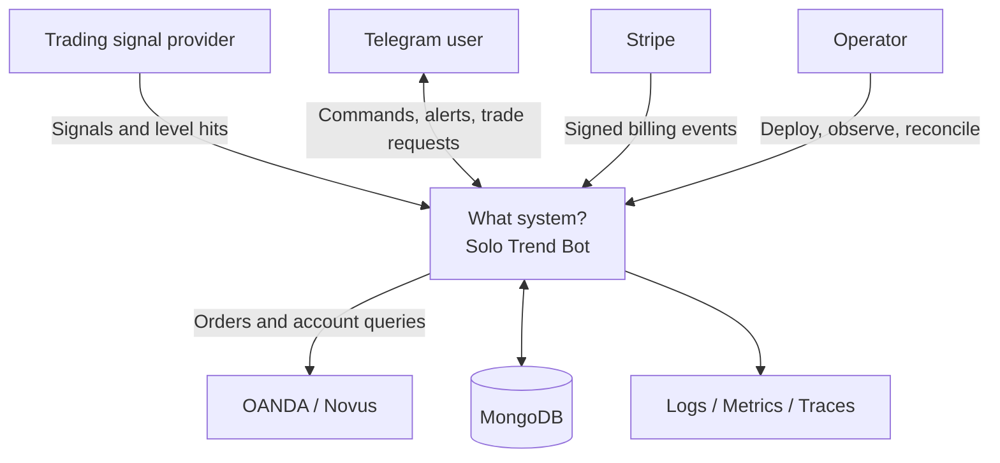
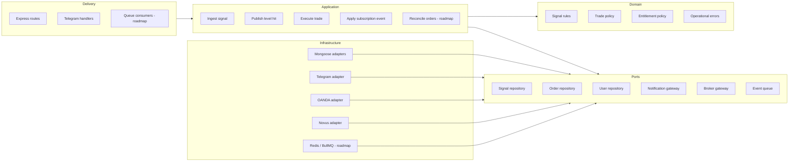
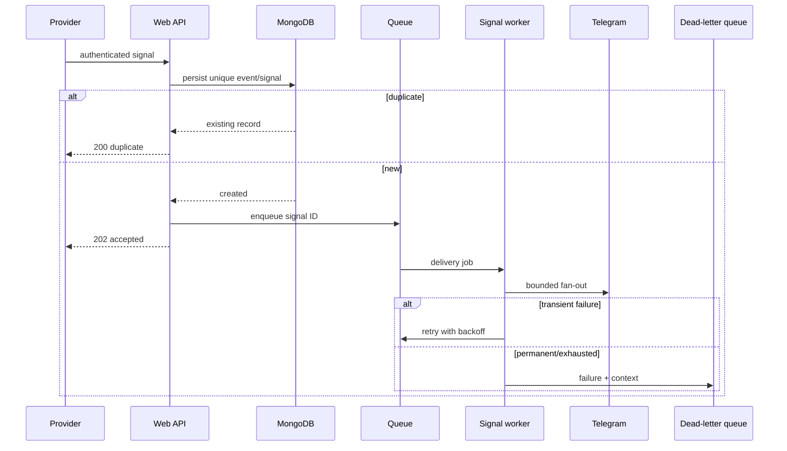
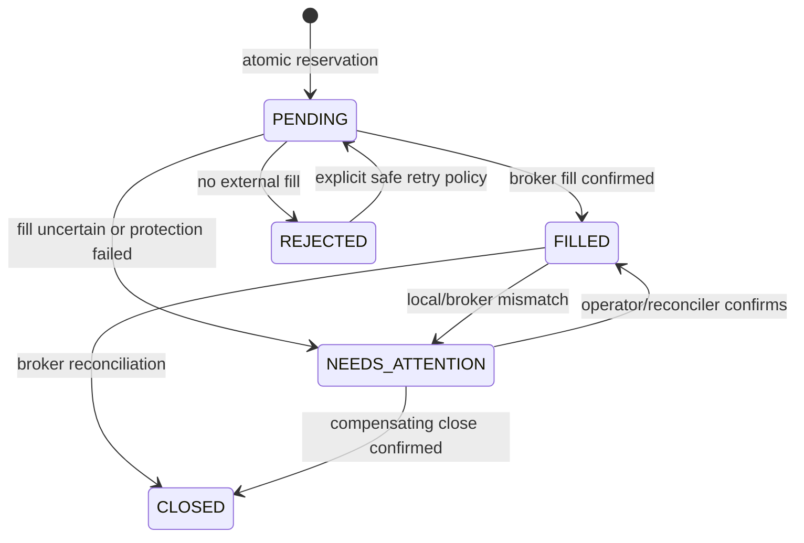

# Target Architecture

## Decision summary

Continue as a modular monolith with explicit domain, application, and adapter boundaries. Split deployment roles only when operational needs justify them; do not split business modules into networked services merely for appearance.

## Context



## Logical components



Arrows represent dependency direction. Domain code must never import Express, Telegram, Mongoose, Stripe, Axios, or a queue package.

## Responsibilities and contracts

| Unit | Does | Depends on | Must not do |
|---|---|---|---|
| Signal domain | Normalize, validate, fingerprint | Node standard library | Database or network calls |
| Ingest signal | Deduplicate, load recipients, coordinate sends | Signal/user repositories, notification gateway | Render Express responses |
| Signal webhook | Authenticate and translate HTTP | Ingestion function | Contain persistence logic |
| Telegram gateway | Escape/render Telegram HTML and buttons | Telegram bot client | Select recipients |
| OANDA execution | Validate trade, reserve, submit, record outcome | Broker/account and order ports | Send Telegram messages |
| Telegram trade handler | Resolve user/signal and present results | Use cases | Build broker payloads |
| Mongoose repositories | Atomic persistence behavior | Mongoose models | Apply business presentation rules |

## Target asynchronous signal flow

The current signal path performs delivery in the request. The production target separates acceptance from processing:



For stronger atomicity, use a MongoDB outbox document in the same transaction as the signal insert. A relay publishes outbox rows to the queue and marks them published. This closes the “database commit succeeded but queue publish failed” gap.

## Target trade state machine



`NEEDS_ATTENTION` is essential for ambiguous external outcomes. A timeout does not prove the broker rejected the request; blindly retrying can duplicate a trade.

## Error model

Application errors should carry:

- stable machine code, such as `SIGNAL_INVALID` or `TRADE_ALREADY_RESERVED`;
- safe user-facing message;
- retry classification: never, safe, or reconciliation-required;
- correlation/event/order identifiers; and
- original cause for internal logging only.

Transport adapters map these errors to HTTP or Telegram. Broker responses and stack traces do not go directly to users.

## Security boundaries

1. **Internet to webhook:** TLS, request size limit, signature/shared-secret authentication, rate limit, replay/idempotency protection.
2. **Application to broker:** secret retrieval, strict timeouts, outbound allow-list, redacted logs, sandbox-first testing.
3. **Application to database:** least-privilege database account, encrypted transport, indexes, backups, migration discipline.
4. **Operator access:** authenticated dashboards, audit log, controlled manual reconciliation.

## Deployment evolution

All roles can use the same repository and modules:

```text
npm run start:api       # Express only
npm run start:bot       # Telegram updates only
npm run start:worker    # signal/trade/subscription jobs
npm run start:scheduler # enqueue scheduled work only
```

This process separation gives independent scaling and smaller failure domains while avoiding the data consistency and release coordination costs of microservices.
