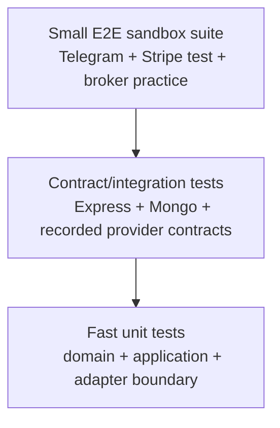

# Testing Strategy

## Goal

Tests should prove the decisions that prevent financial and notification side effects from being repeated. Coverage percentage alone is not the goal.

## Current automated suite

**Status: Implemented — 43 tests in 9 suites**

| Area | Behaviors covered |
|---|---|
| Signal domain | provider/canonical normalization, invalid fields, stable fingerprints |
| Signal ingestion | first delivery, duplicate suppression, partial Telegram failure |
| Signal adapters | Mongo create/duplicate race/error, recipient lookup, Telegram format and HTML escaping |
| Signal webhook | secret rejection, duplicate response, validation response, malformed JSON, level hit |
| Stripe webhook | missing configuration, invalid signature, period-based activation, ignored event |
| Configuration | production/local requirements, secret-safe error, encryption-key format |
| Redaction | nested secrets, arrays, dates, errors, immutability |
| Order service | stable trade keys, atomic reservations, existing reservations, safe outcome updates |
| OANDA use case | canonical broker payload, reservation before submission, duplicate suppression, rejected outcome |

The tests use in-memory fakes at external boundaries. They do not connect to live Telegram, Stripe, MongoDB, OANDA, or Novus.

## Test pyramid



Most behavior belongs in unit tests because the costly risk is orchestration logic. A small number of integration and sandbox tests prove framework and provider assumptions.

## Commands

```powershell
# Complete current suite
npm test -- --runInBand

# One behavior while developing
npm test -- --runTestsByPath tests/unit/trading/executeOandaTrade.test.js

# Coverage report
npm run coverage

# Expose the complete legacy cleanup backlog
npm run lint:all
npm run prettier:all
```

## Test design rules

1. Name the failure a test catches.
2. Derive expected values independently; do not call production builders to create expected output.
3. Exercise real domain/application code.
4. Replace only external or slow dependencies with small behavioral fakes.
5. Assert consumer-visible outcomes and emitted boundary contracts.
6. Every bug begins with a failing regression test.
7. A duplicate-side-effect test must assert the external adapter was not called.

## Next integration tests

### MongoDB repository

Use an isolated test database to prove:

- two concurrent inserts with the same fingerprint create one signal;
- two concurrent reservations with the same trade key produce one `created: true` result;
- unique indexes actually exist after migration;
- legacy signal migration produces valid canonical documents; and
- order lifecycle validators reject invalid transitions.

### Express

Use Supertest with dependency-injected routers to prove:

- Stripe raw bytes reach signature verification unchanged;
- JSON parsing applies to signals but not Stripe;
- request-size limits reject oversized bodies;
- correlation IDs are returned and logged; and
- operational errors map to stable status codes.

### Provider contract tests

Store sanitized response fixtures for:

- OANDA account summary, fill, cancellation, and pending responses;
- Novus account metrics, order response, and position list;
- Stripe invoice/subscription shape; and
- Telegram retry/failure responses.

Contract fixtures should contain all fields the real integration documents, not only fields currently read.

## Sandbox end-to-end checks

These checks should never use real funds:

1. Send one authenticated signal and confirm one Telegram message.
2. Send the identical signal again and confirm no second message.
3. Click the same OANDA practice-account callback twice.
4. Confirm one broker submission and one local order.
5. Trigger a Stripe test subscription payment through Stripe CLI.
6. Confirm invalid signatures do not alter the user.
7. Revoke Telegram chat access and confirm other recipients still receive the signal.

## Failure and concurrency tests

- Run 20 simultaneous identical signal requests; expect one created signal.
- Run simultaneous identical trade callbacks; expect one broker call.
- Delay the database after broker fill; verify reconciliation detects local absence/uncertainty.
- Force a Telegram 429; verify retry delay and bounded attempts once the queue exists.
- Kill the worker during processing; verify job redelivery remains idempotent.

## Load-test questions

Measure rather than assume:

- maximum sustained authenticated webhook rate;
- time to notify 100, 1,000, and 10,000 recipients;
- MongoDB query/index behavior for preference selection;
- queue oldest-job age under bursts;
- memory use from Telegram fan-out; and
- provider rate-limit behavior.

## CI target

```text
install locked dependencies
  -> unit tests
  -> focused integration tests
  -> lint changed files
  -> formatting check
  -> circular dependency check
  -> dependency/security review
  -> build container
  -> sandbox smoke test on protected staging
```

The current repository started without an ESLint configuration and with broad formatting drift. Those are baseline findings, not reasons to weaken new tests. CI should first enforce changed paths, then expand after a dedicated cleanup change.
