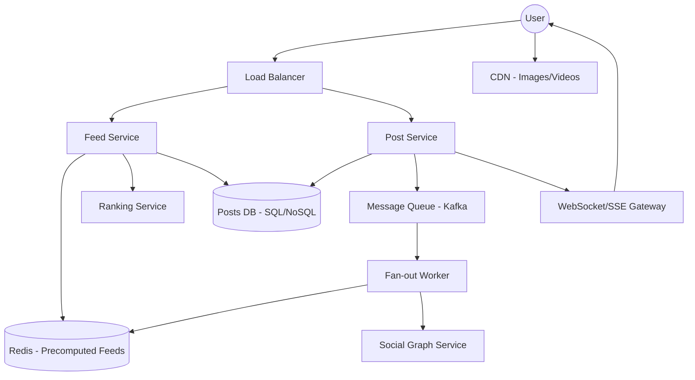
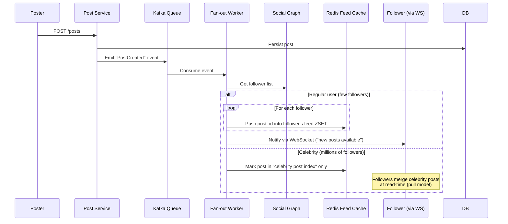

# System Design: News Feed System (Facebook/LinkedIn-style)

## 📋 Requirements Gathering

### Functional Requirements
- Users can create posts (text, image, video, link) and see a personalized, ranked feed of posts from people/pages they follow or are connected to.
- Users can like, comment, share, and react to posts.
- Feed should update with new posts without requiring a full page reload (real-time/near-real-time).
- Support infinite scroll pagination through the feed.
- Support ranking (not pure chronological) — engagement-based ordering mixed with recency.
- Users can see "X new posts" prompt at the top instead of auto-injecting content (avoid scroll-position jump).

### Non-Functional Requirements
- **Low read latency**: Feed must load in <200ms for the first screen (P99).
- **High read:write ratio**: Reads vastly outnumber writes (users scroll far more than they post).
- **Eventual consistency**: Acceptable to show a post a few seconds late to some followers.
- **High availability**: Feed should degrade gracefully (serve stale/cached feed) rather than error out.
- **Scalability**: Must handle users with a handful of connections and "celebrity" accounts with millions of followers (fan-out problem).

### Out of Scope
- Ads ranking/auction system, detailed ML ranking model internals, content moderation pipeline (acknowledged but not designed in depth).

---

## 🏗️ Architecture



### 🖼️ Simple UI Layout (Mental Model)
```
┌─────────────────────────────────────┐
│  [Create Post box]                   │
├─────────────────────────────────────┤
│  ↑ 5 new posts  (click to load)      │
├─────────────────────────────────────┤
│  [Avatar] Name · 2h                  │
│  Post text content...                │
│  [ Image/Video ]                     │
│  👍 Like   💬 Comment   ↗ Share       │
├─────────────────────────────────────┤
│  [Avatar] Name · 5h                  │
│  Post text content...                │
│  👍 Like   💬 Comment   ↗ Share       │
├─────────────────────────────────────┤
│  [ loading skeleton... ]              │
└─────────────────────────────────────┘
```

### 🔄 Data Flow: New Post → Follower Feed (Fan-out)


---

## 📊 Data Model

### Post
```json
{
  "postId": "p_8821",
  "authorId": "u_101",
  "type": "text | image | video | link",
  "content": "Excited to share...",
  "mediaUrls": ["cdn.app.com/img1.jpg"],
  "createdAt": 1735729200,
  "visibility": "public | connections | private",
  "stats": { "likes": 230, "comments": 45, "shares": 12 }
}
```

### Feed Entry (Redis Sorted Set per user: `feed:{userId}`)
```
ZSET feed:u_205
  score: rankScore (or timestamp for chronological fallback)
  member: postId
```
Only `postId` is stored in the feed cache — the full post payload is hydrated from the Post DB / a `post:{postId}` cache on read, keeping fan-out writes cheap.

### Social Graph (edge store)
```json
{ "followerId": "u_205", "followeeId": "u_101", "since": 1700000000 }
```
Indexed both directions: `followers_of:{userId}` and `following_of:{userId}` for fast fan-out and feed composition.

### Engagement
```json
{
  "postId": "p_8821",
  "userId": "u_205",
  "reactionType": "like",
  "createdAt": 1735729300
}
```

---

## 🔌 API Design

| Method | Endpoint | Description |
|---|---|---|
| `GET` | `/feed?cursor={cursor}&limit=20` | Fetch paginated, ranked feed |
| `GET` | `/feed/updates?since={lastPostId}` | Lightweight poll/check for "N new posts" count |
| `POST` | `/posts` | Create a new post |
| `GET` | `/posts/{postId}` | Fetch a single post (deep link) |
| `POST` | `/posts/{postId}/reactions` | Like/react to a post (idempotent, upsert) |
| `DELETE` | `/posts/{postId}/reactions` | Remove reaction |
| `POST` | `/posts/{postId}/comments` | Add a comment |
| `GET` | `/posts/{postId}/comments?cursor=` | Paginated comments |
| `WS` | `/ws/feed` | Subscribe for real-time "new post" events |

**Cursor-based pagination** (not offset-based) is used throughout — the feed is a live, mutating list, so offset pagination would cause duplicate/skipped posts as new items shift positions. The cursor encodes `(rankScore, postId)` of the last seen item.

---

## 🖥️ Frontend Component Architecture

```
<FeedPage>
 ├── <CreatePostBox />                 // optimistic post creation
 ├── <NewPostsBanner count={n} />      // "↑ 5 new posts" — click to prepend
 ├── <VirtualizedFeedList>
 │     ├── <PostCard post={...}>
 │     │     ├── <PostHeader />
 │     │     ├── <PostBody />          // text / image / video (lazy-loaded)
 │     │     ├── <ReactionBar />       // optimistic like/react
 │     │     └── <CommentPreview />
 │     └── <FeedSkeletonLoader />      // shown while fetching next page
 └── <InfiniteScrollSentinel />        // IntersectionObserver trigger
```

- `VirtualizedFeedList` wraps `react-window`/`react-virtual` so only visible `PostCard`s (plus a small buffer) are mounted, keeping DOM node count constant regardless of scroll depth.
- `PostCard` is memoized (`React.memo`) and keyed by `postId` so re-renders from unrelated feed updates don't cascade.
- Media (images/video) uses `loading="lazy"` + an `IntersectionObserver`-driven blur-up placeholder so off-screen media never blocks the main thread.

---

## 🧩 State Management Approach

- **Server cache layer** (React Query / SWR / RTK Query): the feed's paginated post list is treated as server state, not app state — handles caching, dedup of in-flight requests, and background refetch on window focus.
- **Normalized store**: posts are kept in a flat map `{ [postId]: Post }` (not nested arrays) so a single reaction count update re-renders only the one `PostCard`, not the whole list. The feed itself is just an ordered array of `postId`s referencing this map.
- **Optimistic updates**: on like/comment, the normalized store is updated immediately (`stats.likes += 1`, UI flips to red heart), the mutation fires in the background, and on failure the previous snapshot is restored (rollback) with a toast — same pattern as Twitter's like interaction.
- **Real-time delta merge**: WebSocket "new post" events do **not** mutate the rendered feed array directly (that would jump scroll position). Instead they increment a `newPostsCount` in local UI state driving the `<NewPostsBanner>`; only on user click are the new `postId`s prepended.

---

## ⚡ Performance & Scaling Considerations

### 1. Feed Generation: Push vs. Pull vs. Hybrid (Fan-out)
- **Push (fan-out-on-write)**: When a regular user posts, a worker immediately writes the `postId` into every follower's Redis feed ZSET. Reads become O(1) — just read the precomputed list. Great for users with a normal follower count.
- **Pull (fan-out-on-read)**: For celebrity accounts (millions of followers), pushing to every follower's feed on every post would mean millions of writes per post — infeasible. Instead, celebrity posts are left out of per-user fan-out; at read time, the Feed Service merges a small set of "celebrities I follow" posts into the response on the fly.
- **Hybrid approach (used in production systems like Twitter/Facebook)**: Push for the common case, pull for high fan-out accounts, merged at read-time by the Feed Service. This caps both write amplification and read latency.

### 2. Ranking
- Feed is not purely chronological — a Ranking Service scores candidate posts using signals (recency, affinity with author, predicted engagement) and the Feed Service merges/re-sorts the cached candidate list before returning results. Ranking can be computed async and cached per-user for a few minutes to avoid recomputing on every request.

### 3. Caching Strategy
- **L1 — Redis feed ZSET**: precomputed ordered `postId`s per user, TTL-refreshed.
- **L2 — Post object cache**: `post:{postId}` cached independently so a single viral post is fetched once and reused across millions of feeds, instead of re-querying the DB per user.
- **CDN**: all images/video served from CDN edge nodes, decoupled from the API layer entirely.
- **Client-side cache**: React Query cache keeps already-fetched pages in memory so back/forward navigation or returning to the feed tab doesn't refetch.

### 4. Real-Time Updates
- WebSocket (or SSE as a simpler fallback) delivers a lightweight "new post available" event — never the full post payload — to avoid flooding idle clients with data they may never scroll to see.
- Clients batch/debounce these events client-side (e.g., coalesce over 3–5s) so a burst of posts shows as one "12 new posts" banner instead of 12 separate UI flickers.

### 5. Scroll Position & List Stability
- New items are never injected above the user's current viewport automatically — this is the single most common feed UX bug. They're queued behind the `<NewPostsBanner>` and only spliced in on explicit user action, and scroll position is preserved using `scrollTop` anchoring on the first stable DOM node.

---

### Oral Explanation (Interview Ready)

> "The core challenge in a News Feed system is **fan-out at write time vs. read time**. We use a **hybrid model**: push the post into followers' precomputed Redis feeds for normal users, but switch to a pull/merge-at-read strategy for celebrity accounts to avoid a write storm."

1. **Ranking vs. Chronological**: Unlike a simple timeline, we layer a **Ranking Service** on top of the candidate pool to reorder by predicted engagement, cached per-user for a short TTL.
2. **Frontend Stability**: We never auto-inject new posts into a scrolled feed — we surface a **"new posts" banner** and only merge on user intent, combined with **virtualization** to keep the DOM lightweight.
3. **Consistency Trade-off**: The system is eventually consistent — a post may take a few seconds to fan out to all followers — which is an acceptable trade-off for write scalability and availability.

---

## ⚖️ Trade-offs Discussion

| Decision | Benefit | Cost |
|---|---|---|
| Push fan-out for regular users | O(1) fast reads | Write amplification scales with follower count |
| Pull fan-out for celebrities | Caps write cost per post | Slightly slower read path (merge step) |
| Precomputed Redis feed (postId only) | Cheap writes, small cache footprint | Requires a second lookup to hydrate full post data |
| Eventual consistency | High availability, better write throughput | Users may briefly miss/see delayed posts |
| Cursor pagination over offset | Stable pagination despite live inserts | Slightly more complex cursor encoding/decoding logic |
| Client-side "new posts" banner over auto-merge | Predictable scroll position, less jarring UX | Extra click required to see freshest content |
